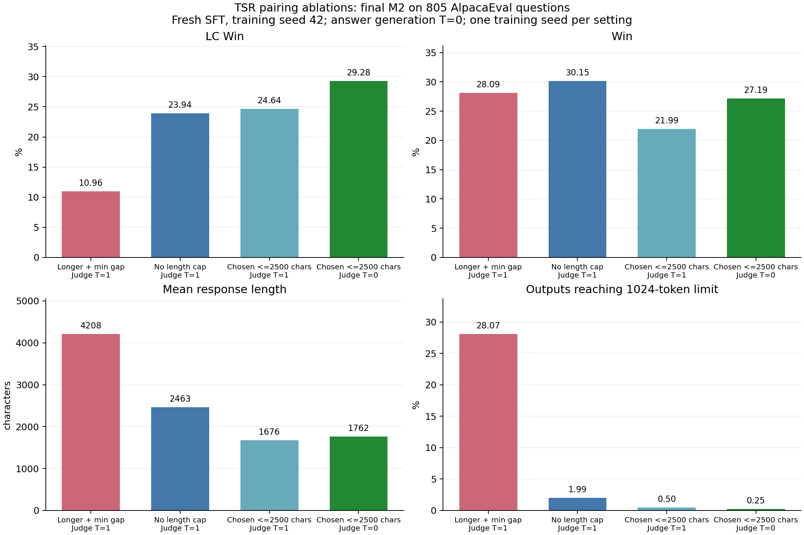

# Reproducing Temporal Self-Rewarding (TSR) on Llama-3.1-8B

## Latest completed pairing experiments (2026-11-13)

The [new experiment archive](experiments/tsr-pairing-ablation-20261113/README.md) contains **17 complete
805-question evaluations**, per-question answers/annotations, native training metrics, actual configs,
pair-filtering statistics and frozen source snapshots. Canceled/failed runs are indexed separately.

| Final M2 setting | Self-judge temperature | LC Win (%) | Win (%) | Mean characters |
|---|---:|---:|---:|---:|
| Chosen <=2500 characters | 0 | **29.28** | **27.19** | 1762 |
| Chosen <=2500 characters | 1 | 24.64 | 21.99 | 1676 |
| Distinct text, no length cap | 1 | 23.94 | 30.15 | 2463 |
| Chosen longer, minimum positive length gap | 1 | 10.96 | 28.09 | 4208 |

All four use fresh Base-to-SFT training, seed 42, global batch 32, self-generation temperature 1,
and evaluation answer generation temperature 0. These are single-training-seed results.
The character cap is applied after score/source priorities without truncating response text.
All four DPO stages of the cap experiments filter score ties, identical text and malformed scores.
Win means AlpacaEval `win_rate`; LC Win additionally controls for response length.



See [cap/temperature settings](docs/CHOSEN_2500_JUDGE_TEMPERATURE_1113.md),
[length-pairing settings](docs/PAIR_LENGTH_ABLATION_1112.md), and [pair rules](docs/PAIR_RULES.md).
CLI defaults and results later in this README document earlier runs; use explicit variant flags for new experiments.

```bash
# Preparation only; submit the generated job.json in your configured SN5 namespace.
python scripts/prepare_sn5.py --run-name my-cap2500-judge0 --gpus 8 --node any-sn5 \
  --variant future_tie_charcap_distinct --max-chosen-characters 2500 \
  --seed 42 --self-judge-temperature 0 --drop-invalid-scores \
  --eval-temperature 0 --eval-final-only --performance-profile h200-fast \
  --zero-stage 2 --dpo-micro-batch 4
# For the paired comparison, change self-judge temperature to 1.
python scripts/archive_pairing_experiments.py --verify experiments/tsr-pairing-ablation-20261113
```

Code and outputs for our reproduction of *Temporal Self-Rewarding Language Models* ([arXiv:2508.06026](https://arxiv.org/abs/2508.06026))
with the official code, [TemporalSelfRewarding/TSR](https://github.com/TemporalSelfRewarding/TSR) at commit `020266a`.
The upstream code is used as is, apart from three small patches (listed below). This repository adds a driver that runs
the whole pipeline (SFT, TSR iter0 and iter1, the SR and w/o Future baselines, AlpacaEval 2.0) with one command, together
with every output behind the numbers reported here.

## Single-copy rerun data (2026-11-04)

The later rerun with duplicate DPO loading fixed is archived in
[experiments/tsr-singlecopy-20261104-best](experiments/tsr-singlecopy-20261104-best/README.md).
Its best completed M2 setting uses `>=` future replacement and removes equal-score preference pairs:
**25.3549 LC / 28.8063 Win** on 805 AlpacaEval instructions. The archive includes the SFT inputs,
both rounds of rollouts and self-judgements, DPO pairs, actual configs/logs, per-instruction evaluation,
source snapshots, and SHA-256 verification. Final M2 weights are unavailable on the replacement server;
the archive documents this gap. The original report and results below remain unchanged.

## Joint closest-length variant (2026-11-12)

`min_length_gap` selects the closest character-length pair jointly from the highest/lowest score pools,
with no model-source preference. Both rounds retain qa1/qa2 and strict positive-score-gap filtering.
See [exact selection and training-only launch](docs/LENGTH_PAIRING.md). This variant has no evaluation results yet.

## Results

The latest complete run, including all metrics, per-question evaluations and figures:
[TSR future-only (2026-11-12)](experiments/tsr-future-only-20261112/README.md).


### Historical future-only run (2026-11-11)

The archived run used `future_only` (now explicit `bash run.sh iter1 future_only`): chosen was always Mf1's highest-scored answer,
even if M1's best answer scores higher. Rejected remains the worst answer across M1 and M0
(ties prefer M1). Only pairs with **chosen score > rejected score** are retained; tied and
reversed preferences are discarded. All candidate scores are produced by M1. D1 and Mf1
training in the archived run retained their existing rules. New runs use the filtered D1 rule below.

The new D2 is rebuilt under `work/data/iter1_future_only/D2` (or the configured `WORK_DIR`)
and the output model is `work/models/M2_future_only`. Historical D2 and M2 are separate.
Run `bash run.sh eval M2_future_only` after training. `bash run.sh iter1 main` explicitly
selects the historical current/future comparison. The completed run and all seven evaluations are archived in
[experiments/tsr-future-only-20261112](experiments/tsr-future-only-20261112/README.md).
M2 reaches **19.3324 LC /29.6734 soft Win**, with mean length3,147 characters.
Mf1 reaches **23.4019 LC /26.6419 soft Win**: future-only raises soft Win but reduces LC.
The tables below describe earlier historical runs, not this new run.

### Corrected default (2026-11-12): current wins source ties

`bash run.sh iter1` now selects `current_tie`, producing `M2_current_tie`.
Both rounds require strict positive-gap D1 and D2 datasets. Mf0/Mf1 D1 chosen is current best;
D2 chosen is the higher-scored best answer among current/future, with **current winning equal scores**.
Rejected is the lowest-scored answer across current/past, also with **current winning equal scores**.
A current/future source tie alone does not discard the pair: filtering compares final chosen to rejected.
This supersedes the previous future-only request. See [exact rules and examples](docs/PAIR_RULES.md).

Cached unfiltered datasets or a different source-tie policy are rejected. Use a fresh run; old future models
and their descendants are not results of the corrected policy. Completed result archives remain unchanged.

The pair builder also exposes `--future-only`, which implies strict positive-gap filtering.
Its `stats.json` records retained chosen sources, minimum score gap, and retained tie count.

AlpacaEval 2.0, judge `gpt-4o-2024-08-06`, reference `gpt4_1106_preview`. LC / Win / mean length (characters).

| Model | Ours | Paper |
|---|---|---|
| SFT (M0, mean of 3 generation seeds) | 7.26 / 5.73 / 1367 | 8.73 / 5.96 / 1324 |
| SR iter0 = w/o Future iter0 (Mf0) | 13.81 / 11.43 / 1597 | SR 13.29 / 10.99 / 1567; w/o Future 14.35 / 11.61 |
| SR iter1 (SR1) | 16.78 / 16.09 / 1827 | 17.00 / 15.71 / 1789 |
| w/o Future iter1 (W1) | 22.45 / 23.37 / 2035 | 20.96 / 19.69 |
| TSR iter0 (M1) | 20.93 / 19.32 / 1810 | 20.48 / 19.07 / 1820 |
| **TSR iter1 (M2)** | **21.78 / 28.38 / 2656** | **27.94 / 29.44 / 2063** |

Everything except TSR iter1 is within 1.5 LC of the paper. The gap is confined to the iter1 step of TSR:

| Change in LC | Paper | Ours [95% CI] |
|---|---|---|
| w/o Future, iter0 → iter1 | +6.61 | +8.63 [+5.75, +10.70] |
| TSR, iter0 → iter1 (M1 → M2) | +7.46 | +0.85 [−2.18, +3.72] |
| TSR − w/o Future at iter0 | +6.13 | +7.12 [+4.51, +9.25] |
| TSR − w/o Future at iter1 | +6.98 | −0.67 [−3.56, +2.20] |

CIs are paired bootstraps over the 805 instructions (`src/analysis/paired_bootstrap.py`, results in `results/paired_bootstrap.jsonl`).
Within iter1, training M1 on the past-anchored pairs alone (Mf1) gives 22.30 / 22.87 / 2012; adding the future upgrade (M2)
makes the outputs 644 characters longer and raises Win by 5.51 [+3.35, +7.64], while LC changes by −0.52 [−3.08, +2.20].

## Differences from upstream

**Patches** (`patches/`, applied by `setup.sh`):

| Patch | Why |
|---|---|
| `0001-dpo-prepend-bos.patch` | trl 0.12.2's `DPOTrainer` drops BOS, while SFT and vLLM inference both start with it. Prepends BOS to every DPO prompt. Without it the M2 output length is 2633 instead of 2656. |
| `0002-sft-model-card-trl012.patch` | `create_model_card(finetuned_from=...)` raises with trl 0.12; the call runs after the weights are saved and is now wrapped in `try`. |
| `0003-iter1-tmp-init-from-iter0.patch` | `config_full_iter1_tmp.yaml` initialises the iter1 future model from `iter0_tmp` (Mf0). The paper (Eq. 5, Alg. 1) and the authors use `iter0` (M1). With upstream's setting M2 gets 18.89 / 28.86 / 3007. |

**Other differences:**

| | Upstream | Here |
|---|---|---|
| GPUs | 8, per-device 4 (SFT) or 2 (DPO) | any count; per-device 2 (SFT) or 1 (DPO), gradient accumulation keeps the global batch at 32 |
| Mf0 global batch | 16 (`config_full_iter0_tmp.yaml` has per-device 1) | 32, like every other DPO run |
| Package versions | lower bounds in `requirements.txt` | the exact environment we ran (`requirements.txt` here): torch 2.5.1, transformers 4.46.3, trl 0.12.2, deepspeed 0.15.4, vllm 0.6.4.post1. Retraining M2 with trl 0.9.6 / transformers 4.43.4 / deepspeed 0.14.4 gave the same length (2697). |
| Generation and judging | `tsr/*.py` with tensor parallelism | the same code, data-parallel over GPUs (`src/tsr_shard.py` imports the upstream class and splits the prompts) |
| Pair construction | `settings/tsr/reformat2DPO_{past,future}.py` | the upstream scripts are run and our re-implementation (`src/build_pairs.py`, which adds the variant flags) must give byte-identical pairs, otherwise the run stops |
| iter0 rejected set | generated a second time with the same model, prompts and seed | the chosen set is reused (identical by construction) |
| AlpacaEval generation | not in upstream | `src/gen_alpaca.py`: training system prompt and chat template, temperature 1.0, top_p 1.0, max 1024 tokens |

`docs/CONFIG.md` lists every hyperparameter, and `results/pairs/*/stats.json` gives the source and length statistics of each pair set.

## Quick start

Requirements: x86_64 Linux, Python 3.11, CUDA driver ≥ 12.4, 2 or more 80 GB GPUs (tested on 2 × A800 80GB),
about 200 GB of disk, a Hugging Face token with access to `meta-llama/Llama-3.1-8B`, and an OpenAI (or OpenRouter) key.

```bash
git clone https://github.com/Tanhhhhtjy/tsr-reproduction.git && cd tsr-reproduction
cp config.env.example config.env        # fill in HF_TOKEN, JUDGE_API_KEY, GPUS
bash setup.sh                           # venv with pinned packages, upstream TSR @020266a + patches, base model
SMOKE=1 bash run.sh all                 # optional: whole pipeline on 16 prompts, 2 steps per training run (~1 h)
bash run.sh all                         # full run; results in work/alpaca_eval/summary.csv
```

Stages can also be run one by one: `bash run.sh sft | iter0 | iter1 | sr | wof | eval [MODEL ...]`.
Each step writes its output once and is skipped when the output exists, so an interrupted run resumes with the same command.
If the judge is reached through a SOCKS proxy, also `pip install socksio`.

### DPO input files

`pairs` stores the upstream comparison beside the pair directory (for example, `D2.official.json`), outside the
training dataset. `make_cfg.py` copies only the requested directory's `train.json` into `configs/<model>.data/`
and points DPO at that isolated directory. SFT keeps its original multi-file dataset loading.

Older pair directories may contain both `train.json` and an identical `official/train.json`. Hugging Face datasets
discovers both recursively, turning 5,000 pairs into 10,000 training rows. The isolated DPO input also fixes loading
from these existing directories without deleting their verification files. Completed checkpoints are still skipped;
use a fresh `WORK_DIR` to retrain checkpoints produced with duplicated inputs. Existing result artifacts are unchanged.

Run the data-loading regression tests in the configured environment:

```bash
.venv/bin/python -m unittest discover -s tests -v
```

On 2 × A800 80GB one generation pass (5,000 prompts × 7 responses) takes about 20 min, one judging pass about 27 min,
one DPO run about 40 min of training plus loading and saving, and SFT about 40 min. The full run takes roughly 13 hours.
Each AlpacaEval evaluation with `gpt-4o-2024-08-06` costs about $2.3.

## Variants we tried

All start from the same M1 and change one thing in iter1. `bash run.sh iter1 <name>` reproduces a row
(definitions in `configs/variants.sh`); `bash run.sh eval M2_<name>` evaluates it.

| Variant | Change | LC / Win / length |
|---|---|---|
| main | upstream rules | 21.78 / 28.38 / 2656 |
| `strict` | paper Alg. 1: upgrade only if the future model is strictly better, keep only s_chosen > s_rejected | 22.30 / 22.87 / 2012 * |
| `iter0_strict` | the same rule at iter0 (M1_strict) | 14.36 / 12.53 / 1637 |
| `rej_past` | rejected: past/current tie goes to past | 20.50 / 23.48 / 2233 |
| `rej_past_conf` | as above, and among same-score candidates take the highest p(score token) | 21.62 / 25.18 / 2288 |
| `cho_longest` | chosen: longest among top-score ties | length 3004 |
| `len_control` | chosen shortest, rejected longest among ties (Meta-Rewarding) | length 1238 |
| `mf1_from_mf0` | iter1 future model initialised from Mf0 (upstream config) | 18.89 / 28.86 / 3007 |
| `resample` | every generation and judgement redone with vLLM seed 1234 | 21.20 / 27.93 / 2618 |
| `iter1_mix` | iter1 DPO on iter0 D2 + iter1 D2 (not the authors' setup) | 23.79 / 26.80 / 2332 |
| `iter0_conf` | iter0 with score × p(score token) as the score | M1 worse than main (cheap judge only) |
| old package versions | trl 0.9.6 / transformers 4.43.4 / deepspeed 0.14.4 | length 2697, same Win as main (cheap judge only) |

\* Under the strict rule only 21 of 5,000 iter1 chosen responses are upgraded, so we reported Mf1 (trained on D1) as a stand-in; `run.sh iter1 strict` trains M2 on the strict, filtered D2 directly.
Rows without LC were not judged by gpt-4o; their outputs are in `results/alpaca_eval/`.

Two observations from the pair data (`src/analysis/tie_stats.py`):

- At iter1, the future and current best scores tie on 99.4% of prompts (4,968 / 5,000, all at 5); the future model is
  strictly better on 21. Under the `>=` rule the chosen response is therefore almost always the future model's.
- The judge writes "earns N points" before `Score: N`, so p(score token) is close to 1 (exactly 1.0 for 31% of judgements).
  Rules based on that probability mostly act as a random tie-break.

## How this was validated

The reported numbers come from the original runs, before the code was reorganised into this repository. Afterwards:

- every pair set was rebuilt from the saved judgement files with `src/build_pairs.py` and compared byte for byte
  against the original pairs (iter0 D1/D2, iter1 D1/D2, all eight variants, SR and w/o Future: identical);
- `src/make_cfg.py` reproduces the SFT and DPO configs of the original runs exactly;
- `setup.sh` was run from scratch into an empty virtualenv, and the whole pipeline (SFT → iter0 → iter1 → SR →
  w/o Future → AlpacaEval generation → judging → summary) was run end to end on 16 prompts with a randomly initialised
  2-layer model. The pair-construction check against the upstream scripts passes at every stage of that run.

A full rerun with Llama-3.1-8B has not been repeated through these scripts.

## What is in this repository

```
config.env.example   the only file to edit (copy to config.env)
setup.sh  run.sh     setup and the pipeline driver
scripts/             lib.sh (gen / judge / pairs / dpo / sft / alpaca helpers), stages.sh (paper stages)
configs/variants.sh  iter1 variants
patches/             the three patches to upstream TSR @020266a
src/                 tsr_shard.py, build_pairs.py, make_cfg.py, gen_alpaca.py, eval_alpaca.py, tsr_conf.py,
                     judge_stats.py, summarize.py, analysis/ (paired bootstrap, tie statistics, Figure 1 pair gap)
results/             alpaca_eval/<model>/ (model_outputs.json, leaderboard.csv), pairs/*/stats.json,
                     training/<model>/trainer_state.json, paired_bootstrap.jsonl, summary tables
docs/CONFIG.md       full configuration
```

The [release](https://github.com/Tanhhhhtjy/tsr-reproduction/releases) has the large files:
`alpaca_eval_annotations.tar.gz` (per-instruction gpt-4o annotations for every judged model) and
`pipeline_data.tar.gz` (all judgement files with the 7 responses, judgements and scores per prompt, the p(score token)
files, and every DPO pair set). The directory names match what `run.sh` writes under `work/data/`.

## License

MIT. The patches modify the MIT-licensed upstream code (© 2025 Yidong Wang & Xin Wang). Model outputs were produced
with Llama 3.1 and are subject to the Llama 3.1 Community License.
