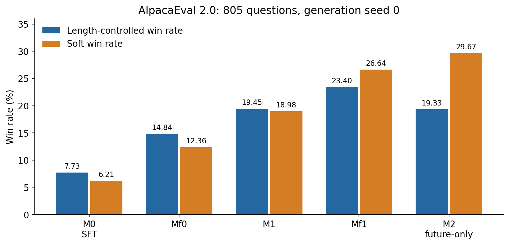
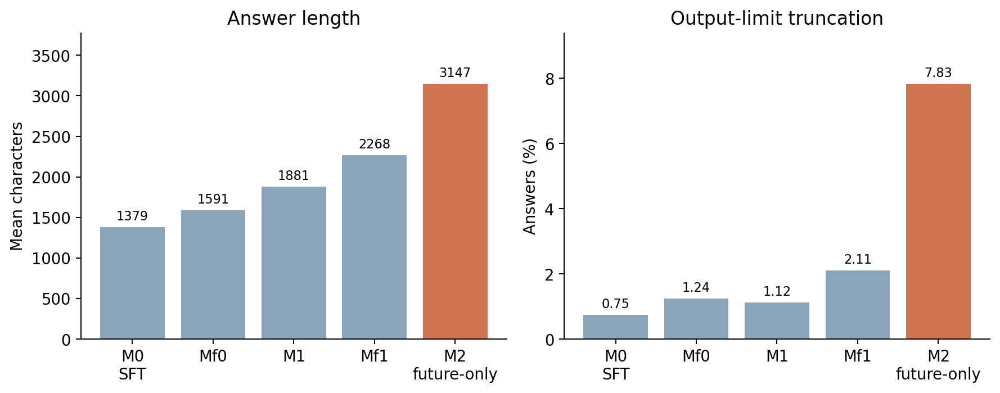
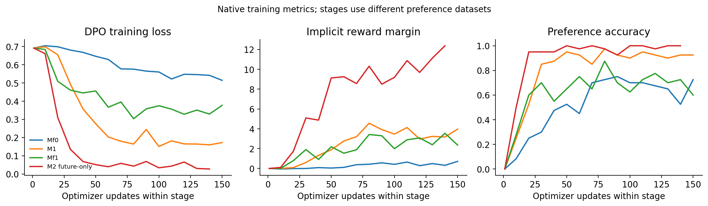
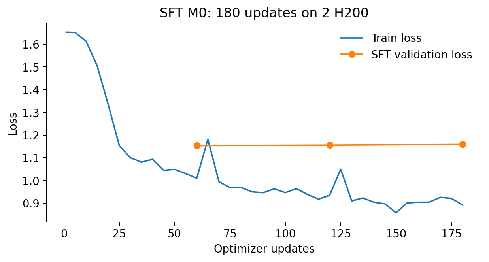

# TSR future-only：2026-11-12 完整结果

本次从经过官方 SHA-256 校验的 Llama-3.1-8B Base 开始训练 SFT，随后完整运行两轮 TSR。
仅修改第二轮 M2 的 D2：chosen 无条件取 Mf1 最高分回答，rejected 取 M1/M0 最低分回答（同分优先 M1），
只保留 chosen 分数严格大于 rejected 的配对。第一轮及 Mf1 的训练规则保持原配置。

**结果：M2 的概率软胜率上升，但 LC 胜率没有提升，并伴随更长回答。Mf1 是本次 LC 最高的阶段模型。**

## 完整 805 题评估

| 模型 | 生成 seed | LC (%) | Soft Win (%) | Discrete Win (%) | 平均字符数 | 输出上限截断率 (%) |
|---|---:|---:|---:|---:|---:|---:|
| M0 | 0 | 7.7340 | 6.2146 | 5.9627 | 1379 | 0.7453 |
| M0_seed1 | 1 | 8.5632 | 6.7032 | 6.3354 | 1399 | 1.3665 |
| M0_seed2 | 2 | 6.4651 | 5.3629 | 5.2174 | 1400 | 2.1118 |
| Mf0 | 0 | 14.8350 | 12.3645 | 12.4845 | 1591 | 1.2422 |
| M1 | 0 | 19.4529 | 18.9813 | 18.3230 | 1881 | 1.1180 |
| Mf1 | 0 | 23.4019 | 26.6419 | 27.1429 | 2268 | 2.1118 |
| M2_future_only | 0 | 19.3324 | 29.6734 | 29.3789 | 3147 | 7.8261 |

M0 三个**生成 seed**均值：LC **7.5874%**，Soft Win **6.0936%**，
Discrete Win **5.8385%**。它们来自同一个 SFT 模型，不是三次独立训练。

评分模型为 `gpt-4o-2024-08-06`，通过 OpenAI 兼容服务调用；reference 为固定的 `gpt4_1106_preview` 回答，
805 条顺序与已有归档一致，SHA-256 见 `provenance/reference.json`。每组均完成 805 条有效、有限的偏好分数。
评分使用原官方 clf 模板，max_tokens=1、temperature=1、logprobs=true、top_logprobs=5、num_procs=3。

- **Soft Win**：由评审 token 概率得到连续偏好后平均，不是硬判胜局比例。
- **Discrete Win**：将偏好转为硬胜负，平局记半胜。
- **LC**：使用 `length_controlled_v1` 估计校正回答长度差异后的胜率。
- 长度取原 leaderboard 的整数平均字符数；更精确的均值保存在各组 `model_outputs.diag.json`。

## 论文和已有复现对比

数值为 LC / Soft Win；论文 Win 列未公开足以确认软/硬统计口径的配置，故只作报告值对照。

| 阶段 | 论文报告 LC / Win | 同学单份数据修复版 LC / Soft Win | 本次 LC / Soft Win（seed0） |
|---|---:|---:|---:|
| M0 | 8.73 / 5.96 | 7.10 / 5.67 | 7.73 / 6.21 |
| Mf0 | 13.29 / 10.99（SR iter0） | 13.01 / 10.54 | 14.84 / 12.36 |
| M1 | 20.48 / 19.07 | 21.01 / 20.07 | 19.45 / 18.98 |
| Mf1 | 未单列相同中间模型 | 21.96 / 22.33 | 23.40 / 26.64 |
| M2 | 27.94 / 29.44 | 25.35 / 28.81（最佳配置） | 19.33 / 29.67 |

论文另报 w/o Future iter0 为14.35 /11.61。论文表2的 TSR iter0 LC 为24.08，与表1、表5的20.48不一致；
此处沿用表1和表5的20.48，不将不同表中的数值混合。

同学的最佳 M2 是 future 分数≥current 时替换 chosen，再过滤同分；其不做过滤的 M2 为23.58 /26.80。
本次是无条件 future-only 和严格正分差，两者不是相同配置的独立重复。训练候选使用8个数据并行分片，
同学使用2个分片；即使 seed 相同，不能保证候选回答逐字相同。

Mf1→M2：LC下降4.0695个百分点、Soft Win上升3.0314个百分点，平均长度增加879字符。
M1→M2：LC下降0.1204个百分点、Soft Win上升10.6921个百分点。单次训练、单个生成 seed 的结果
不能确定统计显著性，也不能将全部差异归因于 future-only 规则。

来源：[TSR 论文](https://arxiv.org/html/2508.06026)、[同学修复后归档](../tsr-singlecopy-20261104-best/README.md)、
[AlpacaEval 指标定义](https://github.com/tatsu-lab/alpaca_eval)。本次仅运行 AlpacaEval，不宣称复现 Arena-Hard、MT-Bench 或其他任务。

## 实际训练配置和来源

| 项目 | 实际配置 |
|---|---|
| SFT | IFT 5,000 + EFT 1,871；2,048 token packing；3 epochs；180 updates；lr2e-6 |
| SFT 并行 | 2 H200 × microbatch2 × accumulation8 = global32 |
| DPO | sigmoid；lr5e-7；beta0.1；1 epoch；cosine；warmup0.1；seed42 |
| DPO 并行 | 8 H200 × microbatch1 × accumulation4 = global32；ZeRO-3；BF16 |
| DPO 长度 | max_length2048，max_prompt_length512；原补 BOS 补丁保留 |
| Mf0 / M1 / Mf1 | 各5,000对，156 updates |
| M2_future_only | 4,732对，148 updates；删除268对同分；保留数据全部 chosen 来自 Mf1；最小分差0.5 |
| 训练候选和自评分 | qa1/qa2各5,000题；每题7回答；T1/top_p1/max_tokens1024；每回答评分1次 |
| 权重初始化 | Base→SFT M0；Mf0/M1 均从 M0；Mf1/M2 均从 M1 初始化 |
| 基础框架 | Transformers4.46.3、TRL0.12.2、DeepSpeed0.15.4、vLLM0.6.4.post1 |

上游 TSR revision：`020266aa9ef3cc35bf81384c9b59f98cff62aa1c`；复现仓库起点：`4328550`。
完整环境见 `provenance/pip-freeze.txt`，各阶段真实 YAML 见 `configs/`。
SFT 21:38至22:01在原2卡任务完成，之后接用完整 M0；8卡任务22:13启动（先做隔离 smoke），
正式最后模型在11月12日00:02保存，全部评估回答生成于00:05完成。以上均为北京时间。

## 文件和验证

- `evaluation/`：7组实际最终回答、诊断、leaderboard、gzip逐题评分和无凭据 annotator 配置。
- `training/`：5个模型的原生 Trainer state、逐步训练指标和最终训练统计。
- `metrics/`：完整精度 JSON/CSV、三生成 seed 均值、各阶段配对统计与 DPO 输入文件哈希。
- `provenance/`：官方基础模型验证、原始输入哈希、SFT接续证据、真实配置来源、运行环境及冻结代码哈希。
- `figures/`：最终评估、回答长度及截断率、SFT/DPO训练曲线，PNG和SVG均可直接查看。

不包含模型权重、优化器、训练 batch、候选轨迹全文、API密钥或私有服务地址。原始 IFT/EFT/qa1/qa2
输入已在前一个归档中保存，本次只校验并引用，不再次复制。DPO 输入仅保留哈希及统计，不上传完整中间数据。
原始路径写在真实配置及来源记录里，用于审计；换机器时需要映射路径。
GPU运行计划是在提供评分接口前冻结的，因此其中 pending credentials 文字是历史计划；
本归档的7组有效评分与文件哈希才是实际完成证据。

在仓库根目录执行，无需GPU、网络或API：

```bash
python scripts/verify_result_archive.py experiments/tsr-future-only-20261112
```

重画图（可使用单独环境，matplotlib3.9.2）：

```bash
python scripts/plot_future_only_results.py experiments/tsr-future-only-20261112
```

## 结果图








