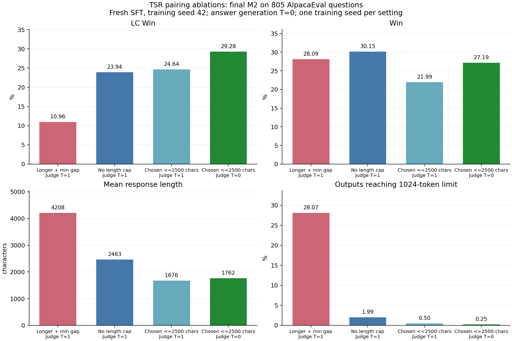
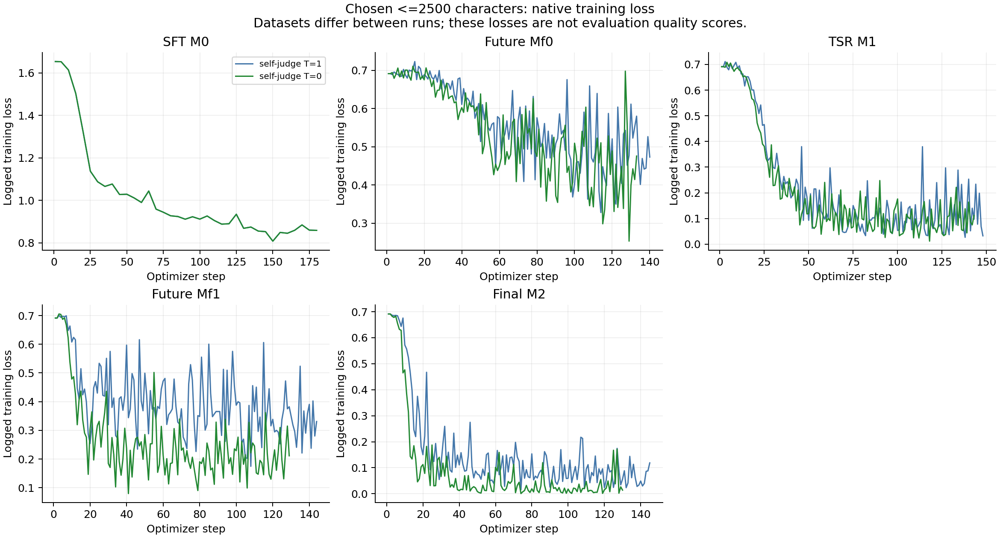

# TSR 配对规则和温度实验记录（2026-11-13）

本目录保存本轮实验的完整评测结果、实际配置、训练指标、配对过滤统计，以及当时运行的代码快照。
模型为 Llama-3.1-8B；最新四组均从 Base 独立训练 SFT，训练种子 42、全局 batch 32。
所有表格的 Win 均指结果文件的 `win_rate`，不是按题目硬判胜负统计的离散胜率。

## 最新四组结果

每组均完成 805 题 AlpacaEval。self-generate=1，评测回答生成=0，GPT-4o 评分裁判设置保持一致。

| 实验 | self-judge 温度 | LC Win (%) | Win (%) | 平均字符数 | 输出截断比例 (%) |
|---|---:|---:|---:|---:|---:|
| chosen ≤2500 字符，self-judge=0 | 0 | 29.28 | 27.19 | 1762 | 0.25 |
| chosen ≤2500 字符，self-judge=1 | 1 | 24.64 | 21.99 | 1676 | 0.50 |
| 仅要求文本不同，不限长度 | 1 | 23.94 | 30.15 | 2463 | 1.99 |
| chosen 更长且正长度差最小 | 1 | 10.96 | 28.09 | 4208 | 28.07 |

字符约束在分数与模型来源优先级确定后执行；无合法 pair 则丢弃该题，不降低分数或切换来源。
字符上限不通过截短文本实现，也不应用于评测回答。两轮四个 DPO 阶段都执行相应规则。
最新 cap2500 两组同时过滤同分、相同文本和异常分数。实验差异和过滤口径见各 run-plan 和配对统计。

这轮 self-judge=0、chosen≤2500 的最终 LC Win 为 29.28%，Win 为 27.19%。
这些是单训练种子实验；长度规则会改变保留数据量，不能只凭一次比较断言普遍优劣。
训练候选和评测回答仍共享 1024 输出 token 上限，输出截断比例已单列。

## 图表





图表同时提供 SVG。DPO loss 受不同训练数据影响，不能直接当作评测质量分数。
可用 `pip install -r requirements-reporting.txt` 安装可选绘图依赖，再运行
`python scripts/plot_pairing_experiments.py experiments/tsr-pairing-ablation-20261113`。

## 文件结构

- `metrics/results.csv`、`results.json`：所有新归档完整评测及温度、长度信息。
- `metrics/pair-filtering.csv`：各训练阶段的配对数量和过滤原因。
- `metrics/run-inventory.json`：完成、取消、失败和未完成运行的索引。
- `runs/<run>/evaluation/<model>/`：完整 805 题回答和评分注释（gzip）、成绩和生成参数。
- `runs/<run>/training/`、`training_metrics/`：原生训练状态、标量指标及推理耗时。
- `runs/<run>/configs/`、`provenance/`、`source_snapshot/`：实际配置、版本/数据校验和执行代码。
- `manifest.json`、`provenance/source-files.json`：归档完整性及原文件校验记录。

只归档分析所需记录。不包含模型权重、优化器状态、训练完整 batch、视觉张量、API 凭据或请求缓存。
训练 preference 数据只保存哈希、规模和统计；评测回答与注释完整保留。
复用历史权重的评测变体见 `model-source.json`；评测种子变化不可当成多训练种子结果。
服务地址和秘密相关配置字段已从 JSON 记录中移除，此类变换在 source-files.json 标注为 sanitized。

## 离线验证

```bash
python scripts/archive_pairing_experiments.py --verify experiments/tsr-pairing-ablation-20261113
```

取消的三种子运行没有完成最终评测，不作为多种子结果。用户取消的 Meta-Rewarding length-control SR baseline
没有提交训练，也没有实现代码纳入本次提交。
